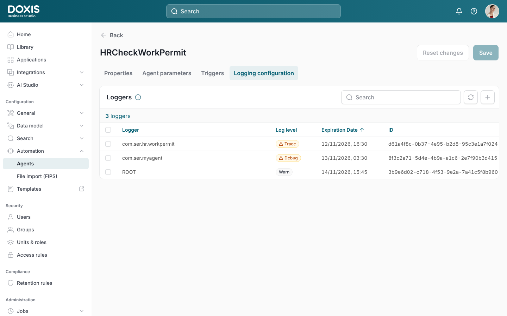
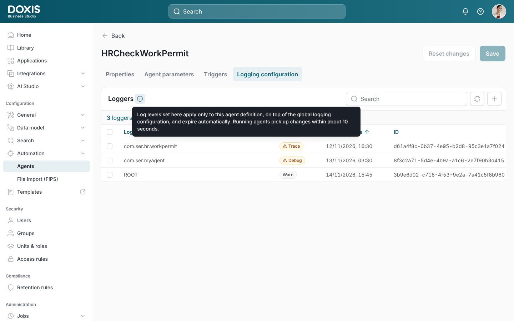
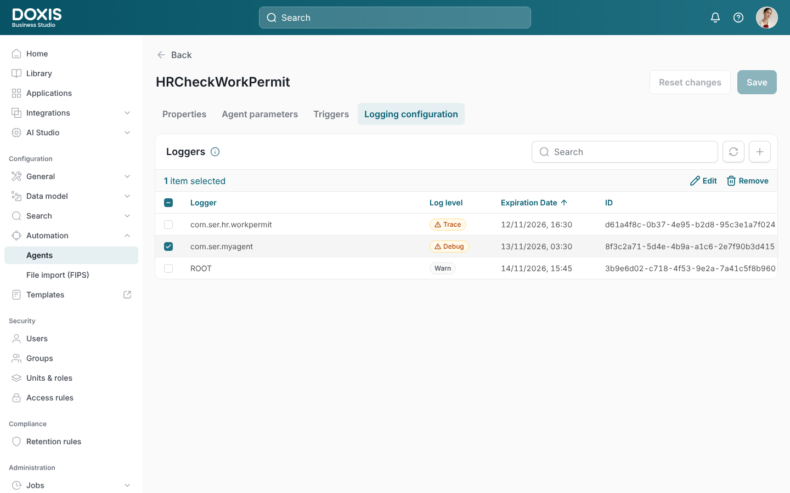
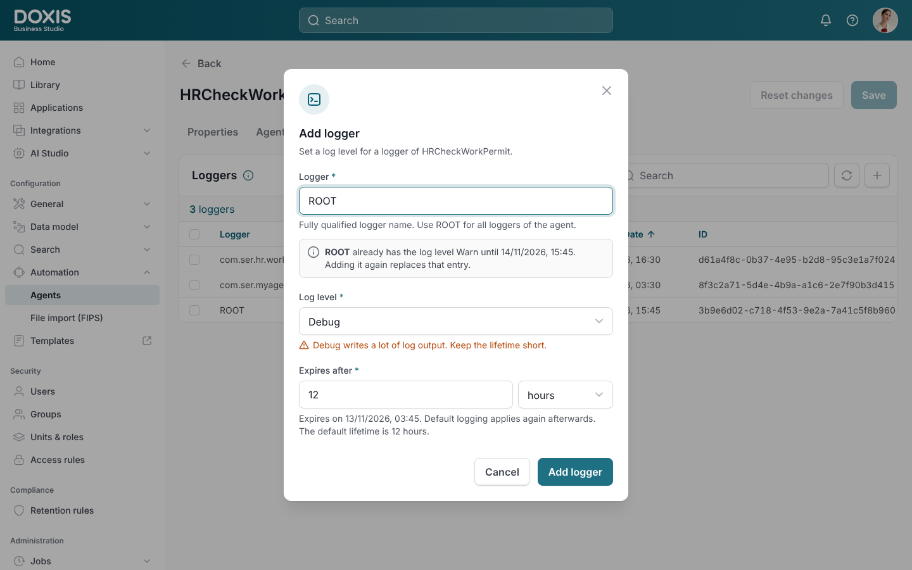
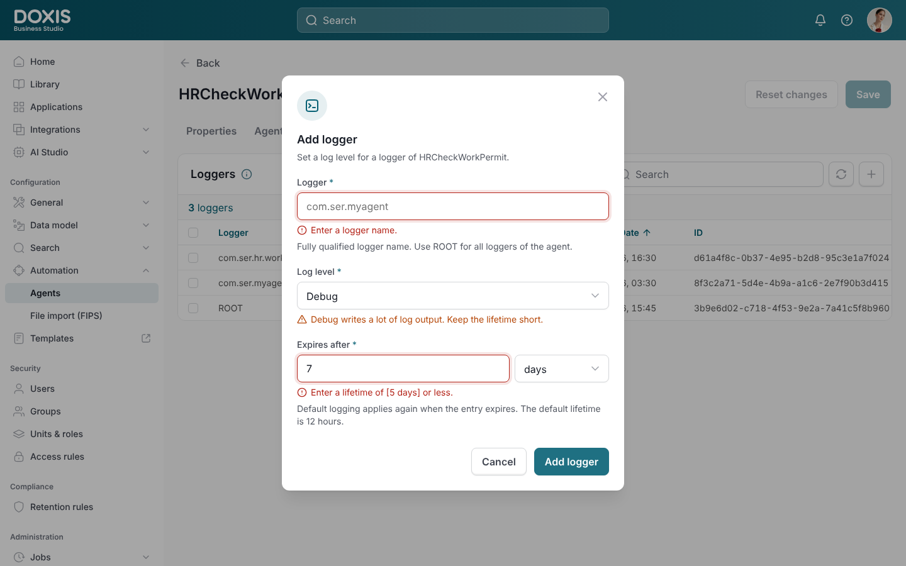
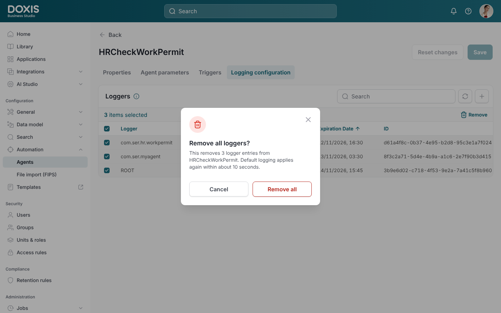
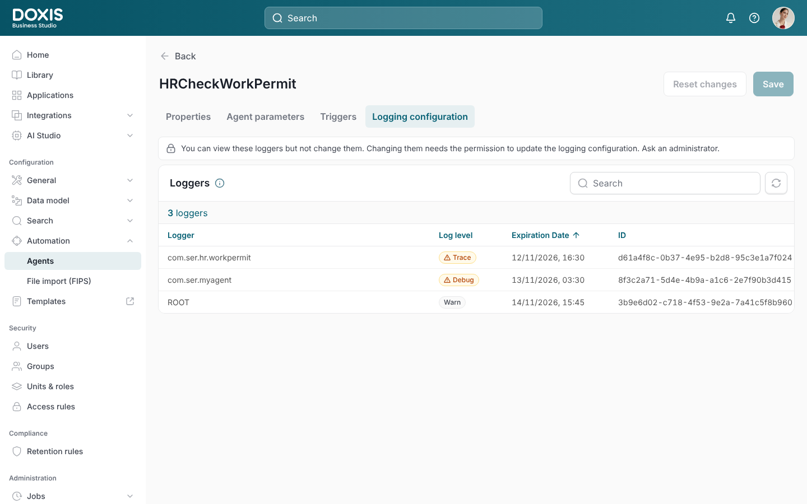
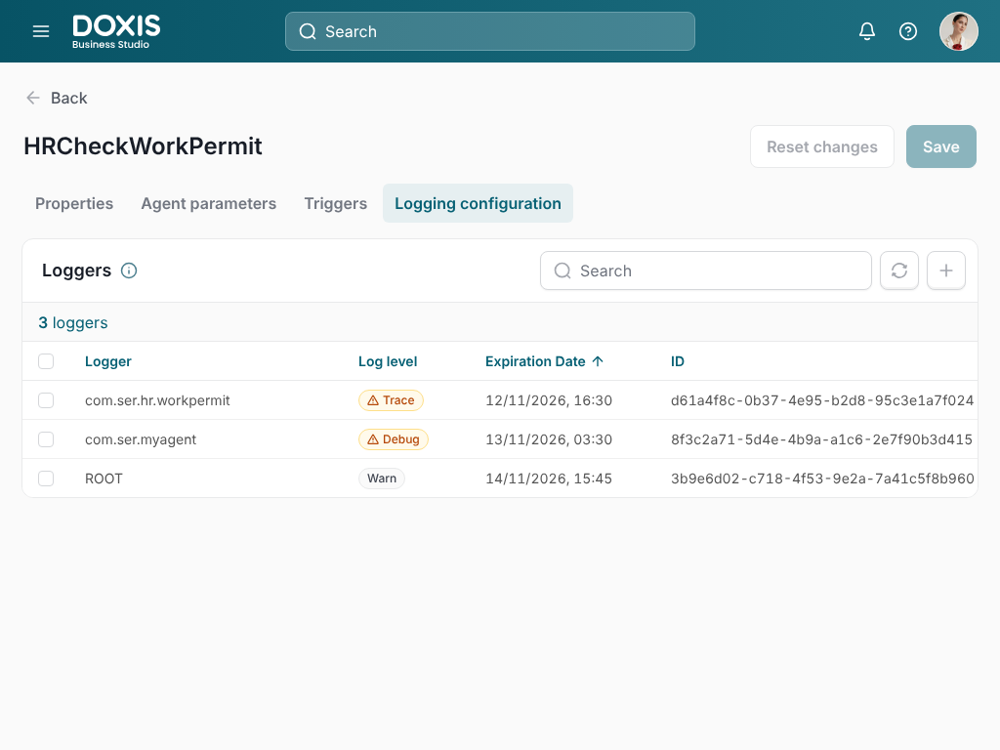
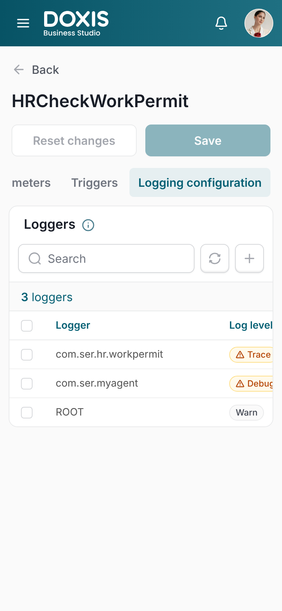
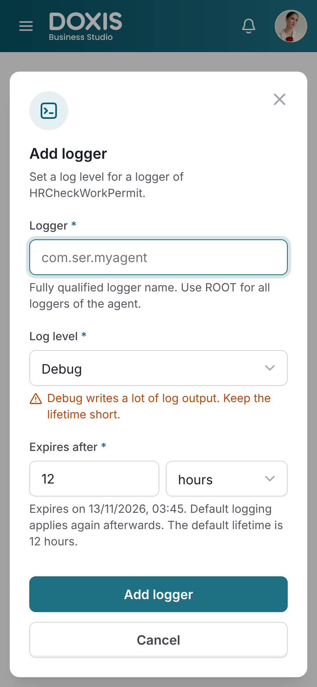

# Logging configuration – Doxis Business Studio prototype

Clickable, responsive prototype of the per-agent **logging configuration** in the Business Studio agent definition editor (agent definition › *Logging configuration* tab).
Plain HTML, CSS and JavaScript: no build step and no dependencies apart from Google Fonts.



| Info tooltip | Row selected |
| --- | --- |
|  |  |

| Add logger | Validation errors |
| --- | --- |
|  |  |

| Remove all | Read-only |
| --- | --- |
|  |  |

| Tablet | Phone | Phone – Add logger |
| --- | --- | --- |
|  |  |  |

## Publish on GitHub Pages (live link)

1. Create a new repository on GitHub (for example `logging-configuration`).
2. Upload the **contents** of this folder to the repository root (drag and drop on github.com › *Add file › Upload files*, or with git):
   ```bash
   cd logging-configuration
   git init -b main
   git add .
   git commit -m "Logging configuration prototype"
   git remote add origin https://github.com/<user-or-org>/logging-configuration.git
   git push -u origin main
   ```
   Make sure the hidden `.github` folder is included (the git commands above do this; drag and drop on macOS may skip hidden folders, so press ⌘⇧. in Finder to show them).
3. In the repository go to *Settings › Pages › Build and deployment* and set **Source** to **GitHub Actions**.
4. The included workflow (`.github/workflows/pages.yml`) deploys on every push to `main`. The link appears under *Settings › Pages*:
   `https://<user-or-org>.github.io/logging-configuration/`

Alternative without Actions: set **Source** to **Deploy from a branch**, choose `main` and `/ (root)`.

## Run it locally

Open `index.html` in a browser (double-click works), or serve the folder with `npx serve .` or `python3 -m http.server`.

## What works

- **Page header**: Back button, agent definition name, Reset changes and Save (disabled; they belong to the other tabs), and the editor tabs with *Logging configuration* selected
- **Loggers table** in the same style as the Agent jobs table: Logger, Log level, Expiration Date (soonest first), ID (the entry's internal ID)
- **Card header** as in Business Studio: "Loggers" title on the left, Search, Reload and an Add (+) icon button on the right
- **Info icon** next to the "Loggers" title: dark tooltip on hover or keyboard focus, pinned open with a click (closes with Escape or a click outside)
- **Search** by logger name, with a "No loggers found" state
- **Row selection**: click anywhere on a row (or its checkbox) to select it, with the bar above the table, with Edit (single selection) and Remove on the right; select all or none from the header checkbox
- **Add logger** and **Edit logger** dialog: logger name, log level (Off … All, shown in sentence case; the values sent to CSB stay lower case: `off` … `all`), lifetime in minutes, hours or days (default 12 hours) with the resulting expiry date
  - warning for Debug, Trace and All (they write a lot of log output)
  - note when the logger already has an entry (adding it again replaces it)
  - validation: missing logger name, spaces in the name, lifetime not a whole number above 0, lifetime above the maximum
- **Remove all**: selecting every logger and choosing Remove asks for confirmation
- **Notifications** with Undo for add, edit and remove
- **Expiry**: expired entries disappear on their own (checked every 15 seconds, or with Reload)
- Double-click a row to edit it; Escape closes dialogs; focus stays inside open dialogs
- The other editor tabs (Properties, Agent parameters, Triggers) show a placeholder

## Prototype states

Use the **Prototype state** switcher in the bottom-left corner, or add `?state=` to the URL:

| State | URL | Shows |
| --- | --- | --- |
| Loggers configured | `index.html` | Three sample loggers |
| Empty | `?state=empty` | "No custom logging configured" with Add logger |
| Read-only | `?state=readonly` | No add, edit or remove; permission note (no `updateLoggingConfiguration`) |
| Loading | `?state=loading` | Skeleton rows |
| Server error | `?state=error` | Error with Try again (loads the sample loggers) |
| Unsupported CSB version | `?state=unsupported` | Section not available on older CSB |
| Unsaved agent definition | `?state=unsaved` | Save the agent definition first |

The switcher is a prototype control, not part of the design.

## Responsive behaviour

| Width | Layout |
| --- | --- |
| > 1100px | Full layout with fixed side menu |
| 721–1100px | Side menu becomes a slide-in menu (hamburger) |
| ≤ 720px | Header search hidden, toolbar wraps, table scrolls sideways, dialogs open from the bottom with full-width buttons |

## Files

```
index.html                    page shell
css/styles.css                design tokens, components, breakpoints
js/app.js                     icons, sample data, state, rendering and interactions
assets/                       Doxis logo and avatar
docs/                         screenshots used in this README
.github/workflows/pages.yml   GitHub Pages deployment
.nojekyll                     serve files as they are (no Jekyll processing)
```

## Notes for development

- Show only the per-agent configuration (`CONF_LOGGING`, type `AGENT_DEFINITION`), never the global logging configuration of the admin server.
- Logging changes are written through the API (`setLogLevel`, `removeLogger`, `removeLoggingConfigurationEntry`, `findLoggingConfigurationEntries`, or the REST endpoints under `/agentDefinitions/{uuid}/…`). In the prototype they apply straight away, separately from the editor's Save; this is a design assumption to confirm (open question 6).
- Log levels are `off`, `fatal`, `error`, `warn`, `info`, `debug`, `trace`, `all` (CSB-3648). The UI shows them in sentence case; send them to CSB in lower case.
- The table can only show levels set for this agent definition. The default level a logger uses without an entry comes from the global configuration in the admin server, which must not be exposed through these calls (CSB-3250).
- The lifetime is entered in minutes, hours or days. Convert it to seconds for `autoExpireAfterSec`.
- Running agents pick up changes within about 10 seconds; expired entries are removed on the server within about 60 seconds, so hide entries on the client once their expiry has passed.
- Without the `updateLoggingConfiguration` permission (admins role by default) the section is read-only.

## Open questions (placeholders in the prototype)

1. Client-Framework (CSB 15.0.0+) or REST (CSB 15.1.0+)? This sets the version in the unsupported state, shown as `[15.0.0]`.
2. What happens when no expiry is passed: 12-hour default or no expiry? The form always sends a lifetime.
3. Is a maximum lifetime enforced? The error uses `[5 days]` as a placeholder.
4. DBS-1457 (target 15.1.0) only asks to integrate the CSB logging configuration into Business Studio and points to the API in CSB-3250; it has no further acceptance criteria. The design is tracked in DBS-1955.
5. Is a separate view across all agents (with an agent filter) also needed?
6. Do logging changes apply straight away, or only with the editor's Save?

Sample data (logger names, levels, IDs) is invented for the prototype; it contains no customer data. Sources: CSB-3223, CSB-3250, CSB-3625, CSB-3648, CSB-3669, DBS-1457.
